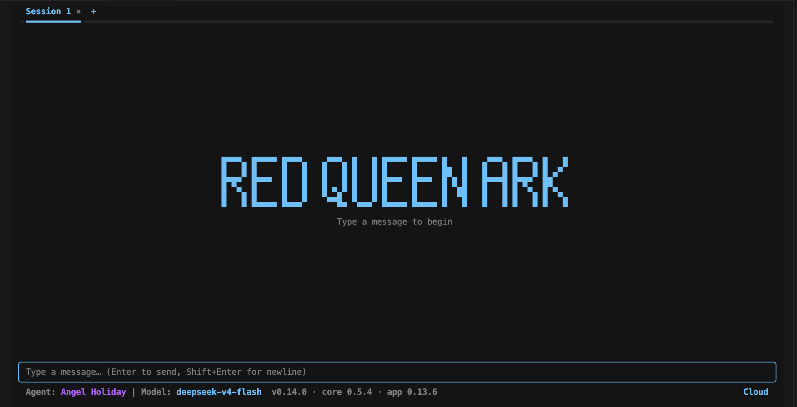
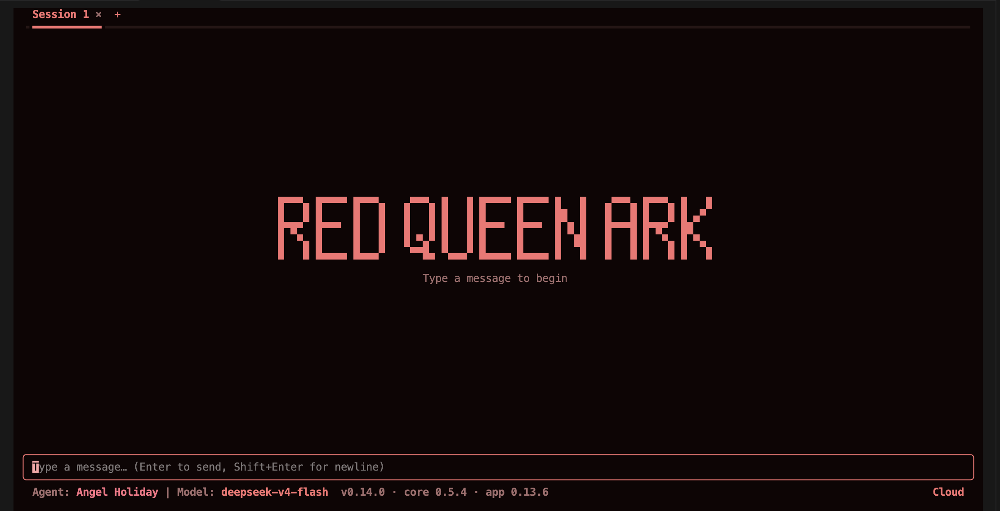
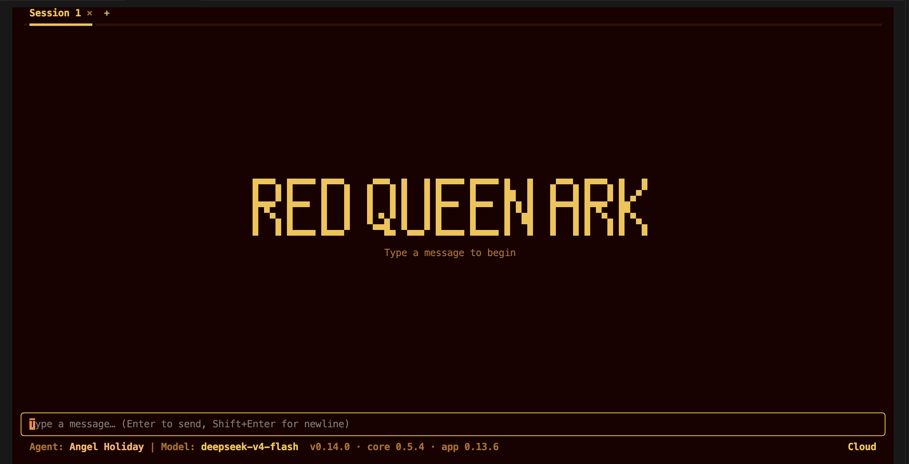
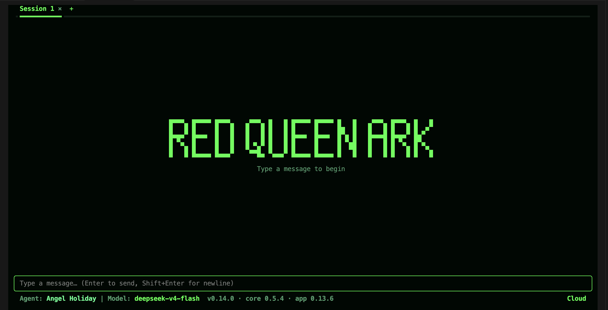

# rqark-tui

A [Textual](https://textual.textualize.io/) terminal chat client for talking to LLM-driven coding agents.

`rqark-tui` is the interface layer only. The chat engine behind it — provider management, session storage, streaming and retries — comes from [`rqark-app`](https://pypi.org/project/rqark-app/).

## Features

- Three-part top-to-bottom layout: session tab bar, message area, input box, with a status bar (agent, model, version, cloud marker) pinned to the bottom
- An empty session shows the Red Queen Ark wordmark in the middle of the message area; it steps aside once the first message is sent
- Streaming chat: reasoning, Markdown content, tool calls and tool results appear as they arrive
- Agents are defined in `~/.rqark/agents/*.yml` (persona, prompt, tools). On first run the directory is seeded with three built-in defaults (Angel Holiday, Diana, Wednesday); switch between them at runtime with `/agents`
- The default agent is stored in `rqark-data-cloud` (one per user per source): when `cloud.yml` is configured the startup sequence reads it back and selects it. To change the default, use the Agent Defaults page of `rqark-data-cloud-web-ui`
- Each project directory has its own sessions: `~/.rqark/dir_caches.json` maps project directories to sessions, so reopening the app in the same project restores the previous conversation
- Multi-provider configuration ordered by `priority`; after 3 consecutive API failures it fails over automatically. Infinite retry inside `app.chat` is intended behaviour — when the context grows too long it is summarised and compressed before continuing
- Thinking blocks and tool results are collapsed by default; expand them with `▶` / `▼`
- `/stop` keeps whatever content had already arrived
- Drag to select text across lines; `Ctrl+C` copies the selection, `Ctrl+A` selects all, and each message has a `[copy]` button in its top-right corner that copies the whole message (to both the app's internal buffer and the system clipboard)
- Multiple sessions can run at once: each has its own message pane, worker and transcript. Switch tabs to watch another session's live progress; sessions do not block each other
- The agent plan is shown in a floating popup with progress markers (` ` pending / `>` in progress / `x` done / `-` cancelled), and only for the current session
- Subagent output stays inside its own session, displayed in an `Agent - <id>` block
- The first message of a new session triggers background title generation, shown on the tab

## Installation

Requires Python ≥ 3.14.

```bash
uv tool install rqark-tui
```

Or add it to a project:

```bash
uv add rqark-tui
```

pip works too:

```bash
pip install rqark-tui
```

## Configuration

Configuration lives in `~/.rqark/` in the user's home directory, shared across projects so it never pollutes individual project directories:

```text
~/.rqark/
├── providers.yml      # provider list (an empty template is created if missing)
├── agents/            # one .yml per agent (seeded with the built-in defaults if missing)
├── dir_caches.json    # project directory (cwd hash) → session
└── sessions/tui/      # one .jsonl per session
```

`dir_caches.json` is keyed by the directory the app was started in (a cwd hash), so every project keeps its own sessions.

Example `agents/*.yml` (`name` uses UpperCamelCase; tool names come from the `TOOLS` table in `rqark-core`, and `params` depend on the tool):

```yaml
name: Diana
description: ''
prompts:
- name: RolePrompt
  params:
    agent_name: Diana
    user_name: Sir
tools:
- name: Gitea
  params:
    username: diana
    token: '...'
    base_url: https://gitea.example
- name: WebSearch
```

Changes to `agents/*.yml` take effect only after restarting the program; `/agents` only switches between agents already loaded. Because the YAML is stored on the local machine and may contain tokens, an agent file with credentials should be `chmod 600` (`~/.rqark` itself is not inside any repository).

The default agent is not stored locally. It lives in `rqark-data-cloud` under the app's source key (`TUI` for this program, and the same value is written onto the session). When `cloud.yml` is configured, startup reads back the default agent for that source and selects it. This program **only reads it, never writes it**; to change the default use the Agent Defaults page of `rqark-data-cloud-web-ui` (or `PUT /api/agent-defaults/{source}` directly). If the agent is deleted or no longer public, that default disappears with it and startup falls back to the first agent in `agents/*.yml` order.

Example `providers.yml`:

```yaml
- name: inhouse
  model_name: gemma4:e4b-mlx
  api_key: '-'
  api_base: http://127.0.0.1:11434/v1
  priority: 1

- model_name: deepseek-v4-flash
  api_key: sk-xxxx
  api_base: https://api.deepseek.com
  priority: 3
```

Available fields: `name`, `model_name`, `api_key`, `api_base`, `priority` (lower wins), plus the optional `reasoning_effort`, `thinking`, `temperature`, `top_p`, `seed`, `frequency_penalty`, `presence_penalty` and `combine`. Providers are used in ascending `priority` order and rotate automatically on failure.

### Themes

Colours live in the JSON files under `src/rqark_tui/tui/themes/`, one file per theme. Every file defines the same set of semantic tokens (`bg`, `surface`, `fg`, `accent`, `user`, `agent`, `tool`, `error`, `selection`, `diff_add`, `code_keyword` and so on). Interface styles and Python renderers read token names only and never hard-code colour values. Adding a theme means dropping in a JSON file; no code changes are needed.

Built in: `default` (the original palette, the default), `redqueen`, `eva` and `matrix`. The colour values of the latter three come from the Dark Theme of `rqark-cloud-web-ui`.

| default | redqueen |
| --- | --- |
|  |  |
| **eva** | **matrix** |
|  |  |

`/theme` opens a picker: like `/models` and `/agents`, use the arrow keys to choose, `Enter` to confirm and `Esc` to cancel. `/theme <name>` switches directly. The change takes effect immediately and is saved to the data cloud as a user setting (key `tui.theme`), so it is restored on the next launch. The `RQARK_THEME` environment variable can still override the startup choice; when there is no cloud connection or no saved setting, `default` is used.

## Startup

The interface is drawn first and the cloud is read afterwards: the input box, header and tab bar appear immediately, while the agent, model, sessions and SOP are filled in in the background. Typing during startup is not lost — `Enter` shows "Still starting" and keeps the input.

## Usage

```bash
rqark-tui
```

Running it again in the same project directory restores every conversation remembered for that directory (one tab each, most recently used first, with the first one on screen).

Layout from top to bottom: header (agent / model / title), session tabs, message pane, popup (plan or menu, only when needed), input box.

```text
<header>
<session tab>   [Session 1] [Session 2] [+]
<main>
<popup>
<footer>
```

### Multiple sessions

- Click `+` (or type `/new`) to open a new session; each session keeps its own message history, in-flight response and input draft
- Switching tabs only changes the message pane above; background sessions keep streaming and show the full content when you switch back
- A session that is responding turns its tab yellow and will not accept another message until it finishes (other sessions are unaffected)
- `/stop`, `/clear` and `/close` only affect the current session
- There are two ways to remove a session, both equivalent: click the `×` on its tab, or type `/close`. Both show a confirmation dialog (`Enter`/`Esc` cancels, `Ctrl+E` confirms, or click the buttons)
- Confirming terminates the in-flight response, then deletes the session's transcript (this cannot be undone). The last session cannot be closed (use `/clear` to empty it) because there must always be one session on screen
- Quitting and reopening in the same directory restores the previous sessions as tabs; deleted ones are not restored

### Key bindings

| Key | Action |
| --- | --- |
| `Enter` | Send the message |
| `Shift+Enter` (or `Ctrl+Enter`, `Ctrl+J`) | Insert a newline |
| `Ctrl+C` | Copy the selection (or the message-pane selection when nothing is selected) |
| `Ctrl+A` | Select all in the message pane |
| `Ctrl+E` | Quit (press again, or `Enter` on the Quit confirmation) |
| `Esc` × 3 | Quit (same confirmation as above) |
| `Tab` / `↑` / `↓` | Move between options in a popup |
| `Esc` | Close the popup / cancel |

Mouse: drag to select text across lines, click `[copy]` to copy a whole message, click `▶` / `▼` to expand or collapse thinking and tool results, click a session tab to switch session, click `+` to open a new session, click `×` on a tab to close that session.

> On macOS terminals (such as Terminal.app) that swallow modifier keys, the program reads the physical keyboard state directly so `Shift/Ctrl+Enter` still inserts a newline.

### Slash commands

Typing `/` brings up the completion list; `Enter` runs the command immediately.

| Command | Action |
| --- | --- |
| `/clear` | Clear the current conversation (delete the session file, keep the tab) |
| `/close` | Close the current session (delete the session file and remove the tab after confirmation) |
| `/compact` | Compress the current conversation into a summary (`Compacting…` is shown while it runs; afterwards only the summary plus new messages are sent) |
| `/new` | Open a new session (same as clicking `+`) |
| `/stop` | Stop the current response (content already received is kept) |
| `/models` | Switch model (the picker lists the available providers) |
| `/agents` | Switch agent (affects the current session only; change the default agent in `rqark-data-cloud-web-ui`) |
| `/theme` | Switch colour theme (opens a picker; `/theme <name>` switches directly) |

While a response is running, ordinary messages are refused ("Still processing — please wait"), but slash commands still work — `/stop` is the escape hatch.

## Development

```bash
uv sync
uv run rqark-tui        # run directly
uv run ruff check --fix
uv run ty check --fix
uv run pyright          # extra type-safety confirmation
uv run mypy
```

Standards: Python ≥ 3.14, ruff line-length 240, single-quote style, and type checking driven primarily by `ruff` + `ty`.
